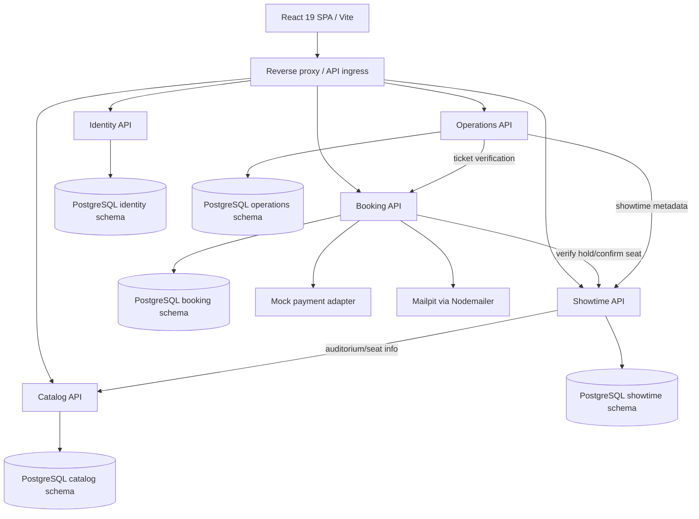
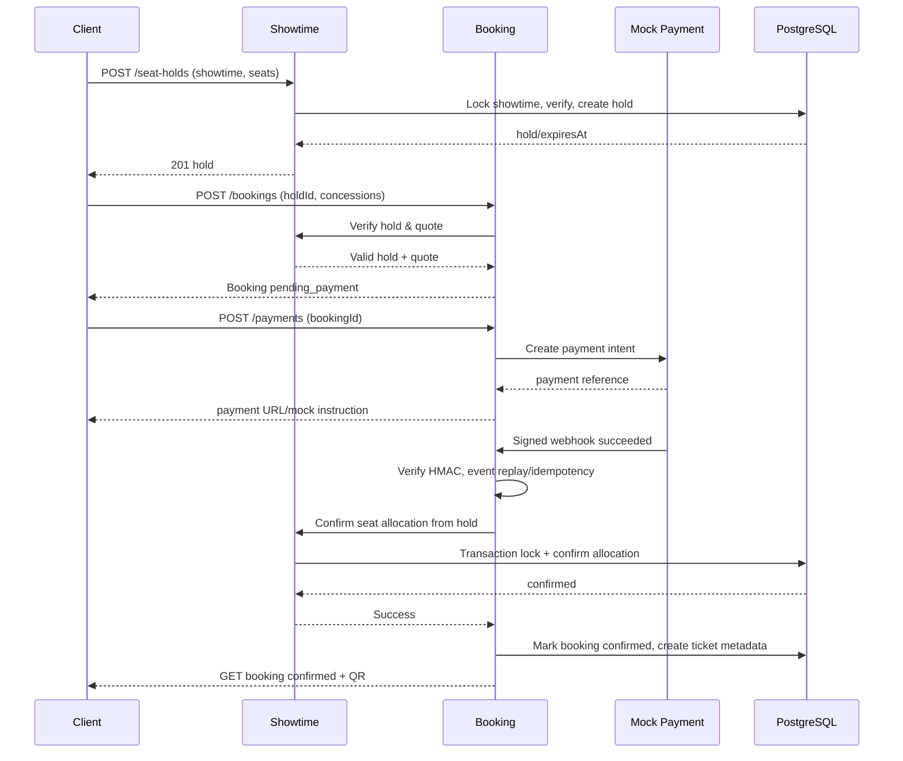

# ARCHITECTURE — Kiến trúc dịch vụ và tích hợp

## 1. Ràng buộc kiến trúc từ đề

- **SPA React client-rendered**; không dùng Next.js/framework full-stack thay thế. React Router 6 chỉ điều hướng chính; SSR **chỉ** trang chia sẻ khi có và không bắt buộc.
- Client **không** truy cập PostgreSQL trực tiếp; mọi dữ liệu qua REST API JSON; hợp đồng OpenAPI 3.1.
- SOA: module nghiệp vụ phải có API và quyền sở hữu dữ liệu rõ ràng, tránh liên kết cứng và truy vấn xuyên vùng sở hữu.
- Docker Compose khởi chạy được toàn hệ thống; mỗi service có healthcheck, structured logging, request ID.

## 2. Phương án được đề xuất

**5 dịch vụ chạy thành 5 Express processes (ACCEPTED D-04)** trong Docker: `identity-service`, `catalog-service`, `showtime-service`, `booking-service`, `operations-service`; thêm `api-gateway` (reverse proxy) nếu cần public một origin. Một PostgreSQL 17 với schema riêng cho từng service là cách tiết kiệm vận hành trong 160h; **không cấp quyền truy vấn schema của service khác** ở application layer. Giao tiếp liên-service qua REST có timeout và lỗi chuẩn. Đây là **quyết định ACCEPTED của nhóm ngày 2026-11-18** (không phải khẳng định đề bắt buộc duy nhất phương án này).

### Sơ đồ thành phần



**Dữ liệu liên service:** chỉ lưu external IDs và snapshot cần thiết; không dùng foreign key xuyên schema như một cách tích hợp nghiệp vụ nếu service độc lập; integrity liên service phải được kiểm bằng API/workflow và đối soát.

## 3. Trách nhiệm từng service

| Service | Chủ sở hữu | API domain | Data ownership | Phụ thuộc |
|---|---|---|---|---|
| Identity | TV1 | `/auth`, `/users`, `/roles` | Users, sessions, roles | Không |
| Catalog | TV2 | `/movies`, `/cinemas`, `/auditoriums` | Movies, cinemas, seats | Identity token verification |
| Showtime | TV3 | `/showtimes`, `/seat-holds`, `/prices` | Showtime, price, holds, seat allocation authoritative | Catalog, Identity |
| Booking | TV4 | `/bookings`, `/payments`, `/tickets`, `/concessions` | Bookings, payment, ticket records | Showtime seat confirm, mock payment, mail |
| Operations | TV5 | `/checkins`, `/reports` | Checkins; báo cáo từ read models/REST | Booking, Showtime, Catalog |

**Chú ý nhất quán:** TV3 là nguồn sự thật về **seat allocation**; TV4 quản lý metadata và trạng thái vé. Booking chỉ `confirmed` sau khi seat confirmation được TV3 chấp thuận. Nếu payment thành công nhưng seat confirmation thất bại, phải đi vào refund/compensation workflow.

## 4. Tương tác liên service và consistency

### Booking success — saga đồng bộ đơn giản [ĐỀ XUẤT]



**Compensation:** Nếu provider callback thành công nhưng hold hết hạn/seat confirm bị từ chối, không tạo vé; đặt `refund_pending` và đối soát. Để hạn chế lỗi khi service ngắt giữa hai bước, triển khai `outbox/reconciliation job` tối giản hoặc cron kiểm tra `payment succeeded, booking pending` để retry idempotent; log có `correlationId`.

### Check-in

Staff → Operations verify JWT và `cinema_scope` → truy vấn Booking `verify-ticket` (internal token) → xác nhận suất/rạp → Operations `checkins` compare-and-set → trả trạng thái. Mỗi vé check-in tối đa một lần bằng `UNIQUE(ticket_id)` ở Operations; không chỉ dựa vào giá trị từ UI.

## 5. Thiết kế frontend

```text
apps/web/src/
  app/              # router, providers, store, query client
  shared/           # design system, UI, api client, validation, utils
  features/
    auth/           # TV1
    catalog/        # TV2
    cinema/         # TV2
    showtimes/       # TV3
    seats/           # TV3
    booking/         # TV4
    payment/         # TV4
    tickets/         # TV4
    checkin/         # TV5
    reports/         # TV5
  pages/            # page composition / layouts
```

- **TanStack Query** quản lý server state, cache, invalidation và polling; **Redux Toolkit** cho client shared state như UI checkout (không sao chép server state vào Redux).
- React Router 6 Data Router: route modules, loader/action khi phù hợp; lazy loading theo trang, poster `loading="lazy"`, giữ aspect ratio.
- Shadcn/ui được tùy biến qua token; form dùng React Hook Form và Zod; error states/keyboard navigation/a11y nhất quán.
- Authentication: ưu tiên access token giữ trong memory, refresh token bằng HttpOnly Secure SameSite cookie; chống CSRF với endpoint cookie.

## 6. Backend convention

```text
services/api/
  gateway/                     # reverse proxy / ingress optional
  identity/
  catalog/
  showtime/
  booking/
  operations/
  packages/
    contracts/                 # shared OpenAPI schemas, types only
    common/                    # errors, logging, auth verifier
```

Mỗi service cấu trúc `routes -> controller -> service -> repository (Knex)`, có validation ở boundary; tránh import repository của service khác. Không dùng Redis làm nguồn sự thật cho ghế nếu không có cơ chế DB bảo toàn tương ứng.

## 7. Reliability & operations

- REST timeout nội bộ đề xuất 2–3 giây với retry có điều kiện; **không retry mù POST không idempotent**.
- Mọi request có `x-request-id`/`traceId`; pino-http JSON log, che PII/tokens/secret.
- `/health/live` và `/health/ready`; ready kiểm tra DB/kết nối cần thiết; Docker `depends_on: condition: service_healthy` khi hỗ trợ.
- DB migrations versioned bằng Knex, seed tiếng Việt idempotent; chạy migration một lần trước khi mở traffic.
- Đo performance theo dữ liệu mẫu thực tế; đơn giản hóa thành ít process hơn nếu đo được overhead hoặc vượt ngân sách thời gian, nhưng phải ghi lại quyết định và vẫn giữ ranh giới SOA/API.

## 8. Rủi ro đã xác định

| Rủi ro | Xác suất/tác động | Phương án |
|---|---|---|
| Distributed consistency seat/payment | Cao/Cao | Server authoritative seat allocation, idempotency, compensation, tests |
| 160h không đủ cho 5 microservices full production | Cao/Cao | MVP đầu tiên, CI sớm, tránh kịch bản quá phức tạp |
| Shared DB vượt ranh giới module | TB/Cao | Per-schema ownership, không truy cập trực tiếp, API contract |
| Thay OpenAPI giữa chừng | Cao/TB | Contract review trước tuần 2, versioning |
| Deploy public / secrets | TB/Cao | Env/secret manager, env example, logs redaction |

## 9. Các lựa chọn còn mở

1. **D-04 ACCEPTED:** triển khai đủ 5 Express processes; không tự ý gộp. Cần chốt cổng/môi trường và ownership credentials.
2. Xác thực token nội bộ: shared public key (asymmetric JWT) hoặc JWKS endpoint; tránh service cần secret ký token.
3. Mock payment service standalone hay adapter nội bộ: adapter nội bộ giúp tiết kiệm công; webhook phải kiểm HMAC như đề.
4. Guest seat-hold token: lifecycle, cookie/session.
5. Dữ liệu báo cáo: REST aggregation MVP, không truy vấn DB khác trực tiếp; cache tùy hiệu năng.


## Các ràng buộc kiến trúc đã chốt (D-04, D-12, D-13, D-14, D-18)

- Bắt buộc **5 Express processes** (Identity, Catalog, Showtime, Booking, Operations), 1 PostgreSQL chia đúng 5 schema; service chỉ được truy cập schema mình sở hữu, gọi service khác bằng REST.
- **Showtime** duy nhất sở hữu và cập nhật seat holds/allocations; Booking không trực tiếp ghi schema Showtime. Sử dụng lock trên showtime và unique active allocation; xử lý bất định phân tán bằng retry idempotent và compensation.
- Mọi API `/internal/*` chỉ chấp nhận **signed service JWT** với `iss`, `aud`, `exp`, `scope/service` và thời gian sống ngắn; không dùng shared secret thô thay cho token nội bộ.
- **Redis** tập trung dùng cho rate limiting và có thể dùng transient cache; ghế có source of truth ở PostgreSQL.
- Tiền `BIGINT` VND và timestamp UTC xuyên toàn bộ API; timezone Việt Nam chỉ dùng để hiển thị.
