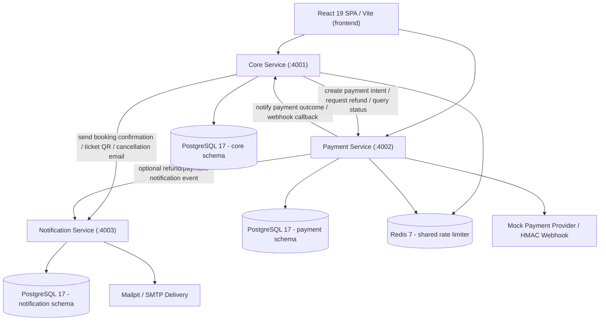
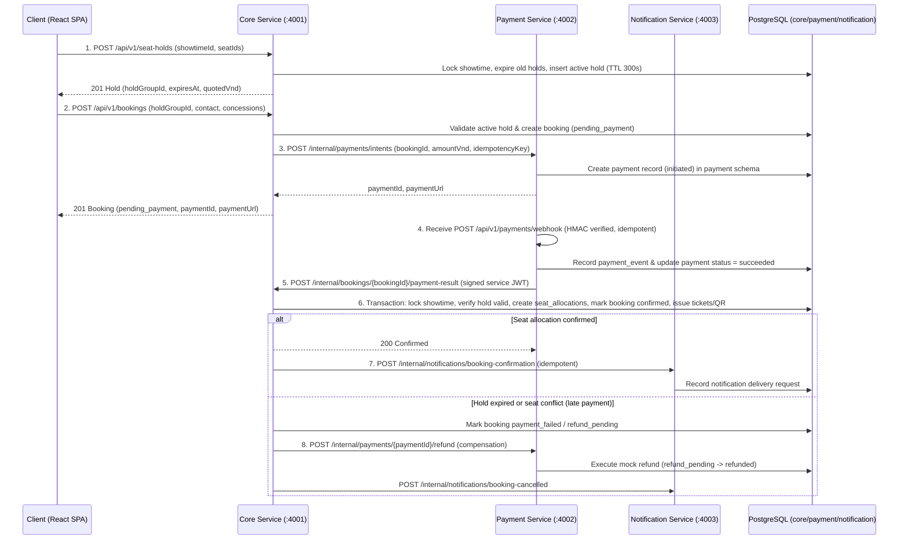

# ARCHITECTURE — Kiến trúc dịch vụ và tích hợp (3-Service SOA)

## 1. Ràng buộc kiến trúc từ đề

- **SPA React client-rendered**; không dùng Next.js/framework full-stack thay thế. React Router 6 chỉ điều hướng chính; SSR **chỉ** trang chia sẻ khi có và không bắt buộc.
- Client **không** truy cập PostgreSQL trực tiếp; mọi dữ liệu qua REST API JSON; hợp đồng OpenAPI 3.1.
- SOA: mỗi dịch vụ có API và quyền sở hữu dữ liệu (schema) rõ ràng, tránh liên kết cứng và truy vấn xuyên vùng sở hữu.
- Docker Compose khởi chạy được toàn hệ thống; mỗi service có healthcheck, structured logging, request ID.

## 2. Phương án kiến trúc hiện hành (`ACCEPTED — REVISED D-04`)

Hệ thống chạy **3 dịch vụ Express 5 độc lập (`ACCEPTED — REVISED D-04`, ngày 2026-11-18, thay thế thiết kế 5 services trước đây)**:

1. **`core-service` (port `4001`, schema `core`)**: Thực thi toàn bộ nghiệp vụ rạp cốt lõi (xác thực & phân quyền, phim/rạp/phòng/ghế, lịch chiếu & giá vé, giữ ghế & phân bổ ghế nguyên tử, đặt vé & bắp nước, phát hành vé QR, soát vé check-in và báo cáo thống kê).
2. **`payment-service` (port `4002`, schema `payment`)**: Thực thi xử lý thanh toán qua mock payment adapter, quản lý giao dịch thanh toán, xác minh webhook HMAC, đảm bảo idempotency và xử lý hoàn tiền giả lập (mock refunds).
3. **`notification-service` (port `4003`, schema `notification`)**: Thực thi gửi email thông báo (xác nhận đặt vé, vé điện tử QR, thông báo hủy/hoàn tiền), quản lý mẫu thông báo và theo dõi trạng thái gửi/thử lại.

Một **PostgreSQL 17** duy nhất được chia thành **3 schema tách biệt (`core`, `payment`, `notification`)**; mỗi service chỉ được phép truy cập schema do mình sở hữu. Giao tiếp liên-service thực hiện qua REST có timeout, retry an toàn và **signed service JWT (D-13)**. **Redis (D-14)** được dùng chung cho rate limiting.

### Sơ đồ thành phần



**Dữ liệu liên service:** chỉ lưu external IDs (`booking_id`, `payment_id`, `user_id`) và snapshot cần thiết; không dùng foreign key xuyên schema giữa `core`, `payment`, `notification`; toàn vẹn liên service được đảm bảo bằng REST workflow, idempotency key và cơ chế đối soát.

## 3. Trách nhiệm từng service & phân công 5 thành viên (TV1–TV5)

| Service | Schema | Modules trong service | Chủ sở hữu (TV) | API domain chính | Phụ thuộc dịch vụ |
|---|---|---|---|---|---|
| **Core Service** (`core-service`) | `core` | `auth`, `users`, `roles` | **TV1** | `/api/v1/auth`, `/api/v1/users` | Redis (rate limit) |
| **Core Service** (`core-service`) | `core` | `movies`, `cinemas`, `auditoriums`, `seats` | **TV2** | `/api/v1/movies`, `/api/v1/cinemas`, `/api/v1/auditoriums` | Auth middleware nội bộ |
| **Core Service** (`core-service`) | `core` | `showtimes`, `pricing`, `seat-holds` | **TV3** | `/api/v1/showtimes`, `/api/v1/seat-holds` | `seats`/`auditoriums` trong Core |
| **Core Service** (`core-service`) | `core` | `bookings`, `concessions`, `tickets` | **TV4** | `/api/v1/bookings`, `/api/v1/concessions`, `/api/v1/tickets` | `seat-holds` (Core), Payment Service, Notification Service |
| **Core Service** (`core-service`) | `core` | `checkins`, `reports` | **TV5** | `/api/v1/checkins`, `/api/v1/reports` | `tickets`/`bookings`/`showtimes` (Core) |
| **Payment Service** (`payment-service`) | `payment` | `payments`, `webhooks`, `refunds` | **TV4** | `/api/v1/payments`, `/internal/payments/*` | Core Service, Notification Service |
| **Notification Service** (`notification-service`) | `notification` | `email`, `templates`, `delivery` | **TV5** | `/internal/notifications/*` | Mailpit / SMTP |

**Chú ý nhất quán:**
- **Core Service** là nguồn sự thật duy nhất (authoritative owner) về **trạng thái ghế, giữ ghế (`seat_holds`) và phân bổ ghế (`seat_allocations`)** cũng như vòng đời đơn đặt vé (`bookings`) và vé (`tickets`).
- **Payment Service** sở hữu dữ liệu giao dịch thanh toán (`payments`, `payment_events`, `refunds`) và không trực tiếp sửa bảng của Core.
- **Notification Service** xử lý gửi thông báo bất đồng bộ/idempotent; **lỗi gửi thông báo không bao giờ làm vô hiệu hóa một booking đã `confirmed`**.

## 4. Tương tác liên service và consistency

### Quy trình đặt vé — thanh toán — cấp vé — gửi thông báo



### Idempotency, Retries, Timeouts & Failure Handling

- **Timeouts:** Các lời gọi REST nội bộ giữa `core-service`, `payment-service` và `notification-service` đặt timeout `2000–3000ms`.
- **Idempotency:** Mọi yêu cầu tạo payment intent, thông báo kết quả thanh toán, yêu cầu hoàn tiền và gửi email đều bắt buộc đính kèm `Idempotency-Key` (hoặc `eventId`/`bookingId` duy nhất). Gọi lặp với cùng key trả về kết quả đã xử lý, không tạo giao dịch hay phát hành vé lần hai.
- **Compensation (Thanh toán trễ sau khi hold hết hạn):** Nếu webhook báo `succeeded` nhưng `seat_holds` tại Core đã hết hạn 300 giây, Core **không phát hành vé**, chuyển trạng thái cần hoàn tiền và gọi `POST /internal/payments/{paymentId}/refund` sang Payment Service để hoàn tiền giả lập.
- **Cô lập lỗi Notification:** Nếu `notification-service` tạm thời lỗi hoặc timeout ở bước 7, `core-service` vẫn giữ nguyên trạng thái `booking = confirmed` và `tickets = valid`, ghi nhận trạng thái cần gửi lại (retry/outbox) để không làm hỏng giao dịch của khách.

## 5. Thiết kế frontend

```text
frontend/src/
  app/              # router, providers, store, query client
  components/       # ui, common, layout, feedback
  lib/              # api client, auth token storage, utils
  features/
    auth/           # TV1
    movies/         # TV2
    cinemas/        # TV2
    showtimes/      # TV3
    seats/          # TV3
    bookings/       # TV4
    payments/       # TV4
    tickets/        # TV4
    checkins/       # TV5
    reports/        # TV5
    notifications/  # TV5
```

- **TanStack Query** quản lý server state, cache, invalidation và polling; **Redux Toolkit** cho client shared state.
- **API Routing:** Frontend giao tiếp chính với `core-service` (`VITE_API_BASE_URL` / `VITE_CORE_API_URL`) và `payment-service` (`VITE_PAYMENT_API_URL`), hoặc qua một cổng reverse proxy duy nhất khi triển khai.

## 6. Cấu trúc Backend

```text
backend/
  core-service/
    src/
      config/
      common/
      modules/
        auth/ users/ roles/
        movies/ cinemas/ auditoriums/ seats/
        showtimes/ pricing/ seat-holds/
        bookings/ concessions/ tickets/
        checkins/ reports/
  payment-service/
    src/
      config/
      common/
      modules/
        payments/ webhooks/ refunds/
  notification-service/
    src/
      config/
      common/
      modules/
        email/ templates/ delivery/
packages/
  api-contracts/
  shared-types/
  shared-utils/
  eslint-config/
```

Mỗi module trong `core-service` giữ ranh giới rõ ràng (`routes -> controller -> service -> repository`), không tạo phụ thuộc vòng (circular imports) và không gộp chung vào một file khổng lồ.

## 7. Các ràng buộc kiến trúc đã chốt (D-04 Revised, D-05..D-18)

- **3 Express processes độc lập** (`core-service`, `payment-service`, `notification-service`), 1 PostgreSQL chia đúng **3 schema (`core`, `payment`, `notification`)**; mỗi service chỉ truy cập schema mình sở hữu.
- **Core Service** duy nhất sở hữu và cập nhật `seat_holds`, `seat_allocations`, `bookings` và `tickets` bằng PostgreSQL transaction locks và partial unique indexes.
- **Payment Service** sở hữu giao dịch thanh toán, xác thực HMAC webhook và hoàn tiền giả lập.
- **Notification Service** sở hữu việc gửi email và theo dõi trạng thái gửi; lỗi gửi thông báo không làm hủy vé đã xác nhận.
- Mọi API `/internal/*` chỉ chấp nhận **signed service JWT (D-13)** với `iss`, `aud`, `exp`, `scope`.
- **Redis (D-14)** dùng chung cho rate limiting; tiền lưu `BIGINT` VND và thời gian lưu UTC (`timestamptz`) theo **D-18**.
