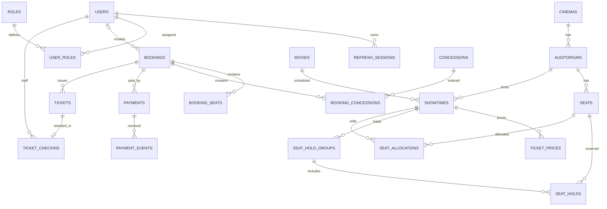

# ERD — Thiết kế dữ liệu PostgreSQL 17 / Knex 3

**Mức độ:** Logical design; quy tắc dữ liệu D-04/D-12/D-15/D-18 đã **[ACCEPTED 2026-11-18]**; chưa phải migration đã chạy. Các ràng buộc xuyên service phải kiểm bằng workflow/API, không giả định FK xuyên database độc lập.

## 1. Quy tắc chung

- `id`: UUID, `created_at`, `updated_at` UTC timestamptz, các số tiền `amount_vnd BIGINT` (không âm trừ dòng điều chỉnh rõ loại), `expires_at timestamptz`.
- Identifier/JSON/database cột dùng tiếng Anh; nội dung hiển thị tiếng Việt. Hiển thị theo Asia/Ho_Chi_Minh.
- Index ở mọi foreign key nội bộ, `(showtime_id, seat_id)`, status, thời gian, tên/tìm kiếm.
- Soft delete dữ liệu có booking tham chiếu; không hard delete lịch sử thanh toán/vé.

## 2. Entity inventory (owned by service)

### Identity (TV1)

| Bảng | PK | Các cột đáng chú ý | Ràng buộc |
|---|---|---|---|
| `users` | id | email, password_hash, full_name, status, verified_at | unique normalized email |
| `roles` | id | code (`customer/staff/manager/admin`) | unique code |
| `user_roles` | id | user_id, role_id, cinema_id nullable | unique scoped association |
| `refresh_sessions` | id | user_id, token_hash, expires_at, revoked_at, rotated_from | hash-only, rotation |
| `email_verifications` | id | user_id, token_hash, expires_at, consumed_at | one-use hash |

### Catalog (TV2)

| Bảng | PK | Các cột đáng chú ý | Ràng buộc |
|---|---|---|---|
| `movies` | id | title, synopsis, duration_min, age_rating, poster_url, status | duration >0 |
| `cinemas` | id | name, address, city, status | name+address indexed |
| `auditoriums` | id | cinema_id, name, supported_formats, status | unique(cinema_id,name) |
| `seats` | id | auditorium_id, row_label, seat_number, seat_type, couple_pair_id nullable, is_active | unique(auditorium_id,row_label,seat_number); couple pair exactly 2 seats |

### Showtime (TV3)

| Bảng | PK | Các cột đáng chú ý | Ràng buộc |
|---|---|---|---|
| `showtimes` | id | movie_id, auditorium_id, starts_at, ends_at, format, state, cinema_id | ends_at > starts_at; prevent overlap |
| `ticket_prices` | id | showtime_id, seat_type, amount_vnd | unique(showtime_id,seat_type) |
| `seat_hold_groups` | id | showtime_id, owner_ref, expires_at, status, idempotency_key | hold lifecycle |
| `seat_holds` | id | hold_group_id, showtime_id, seat_id, expires_at, status | effective active holds cannot conflict |
| `seat_allocations` | id | showtime_id, seat_id, booking_id, status, confirmed_at | unique active allocation for seat |

> **Đồng thời:** Index thông thường không thể dùng điều kiện động `expires_at > now()` trong partial unique index. Đề xuất dùng transaction serialize theo hàng `showtimes` + dọn expired holds + unique trên **slot hiện hữu** hoặc bảng `seat_occupancy` authoritative; test race bắt buộc. `seat_allocations` có partial unique index `UNIQUE(showtime_id,seat_id) WHERE status='active'` (không phụ thuộc now). `seat_holds` cũng có partial unique cho `status='active'` sau khi expired hold được chuyển trạng thái trong transaction. Khi hủy vé, đánh dấu allocation inactive để mở bán lại.

### Booking (TV4)

| Bảng | PK | Các cột đáng chú ý | Ràng buộc |
|---|---|---|---|
| `bookings` | id | user_id nullable, guest_email, guest_token_hash, hold_group_id, status, total_vnd, expires_at | ownership + idempotency |
| `booking_seats` | id | booking_id, showtime_id, seat_id, unit_price_vnd | unique booking-seat |
| `concessions` | id | name, unit_price_vnd, is_available | nonnegative |
| `booking_concessions` | id | booking_id, concession_id, quantity, unit_price_vnd | quantity >0 |
| `payments` | id | booking_id, provider, provider_payment_id, status, amount_vnd, processed_at | unique provider reference |
| `payment_events` | id | provider_event_id, payment_id, event_type, received_at, signature_valid | unique(provider_event_id) |
| `tickets` | id | booking_id, showtime_id, seat_id, qr_token_hash, status, issued_at | stable unique QR token, ticket metadata |

### Operations (TV5)

| Bảng | PK | Các cột đáng chú ý | Ràng buộc |
|---|---|---|---|
| `ticket_checkins` | id | ticket_id, staff_id, showtime_id, checked_in_at | unique(ticket_id) |
| `audit_logs` (hoặc shared logs) | id | actor_id, action, target_id, metadata_redacted, at | append-only |

**Không yêu cầu `reports` table** trong MVP: reports là tổng hợp từ nguồn chuẩn qua internal REST/read model rõ quyền truy cập.

## 3. Quan hệ tổng thể (logical; external refs = dashed conceptual)



## 4. Physical/index constraints mẫu (Knex migration checklist)

```sql
-- Các câu lệnh minh họa; mapping schema/tables tùy cấu trúc migration thực tế
CREATE UNIQUE INDEX uq_seat_allocation_active
  ON showtime.seat_allocations(showtime_id, seat_id)
  WHERE status = 'active';
CREATE UNIQUE INDEX uq_seat_hold_active
  ON showtime.seat_holds(showtime_id, seat_id)
  WHERE status = 'active';
CREATE UNIQUE INDEX uq_payment_event_id
  ON booking.payment_events(provider_event_id);
CREATE UNIQUE INDEX uq_checkin_ticket
  ON operations.ticket_checkins(ticket_id);
CREATE INDEX idx_showtime_filter
  ON showtime.showtimes(cinema_id, starts_at, state);
```

**Quan trọng:** Trước khi tạo hold mới, transaction phải cập nhật `seat_holds.status='expired'` cho tất cả expired holds của suất, rồi kiểm tra và ghi hold. Khóa hàng suất trước khi làm bước này để ngăn cạnh tranh. Quá trình xác nhận allocation và hủy phải theo cùng lock order để tránh deadlock.

## 5. Data lifecycle và bảo vệ thông tin

- Refresh/token/QR guest: chỉ lưu hash; không lưu JWT hoặc plaintext secret trong logs.
- Payment events: metadata tối thiểu, che các trường nhạy cảm và payload thô nếu cần audit.
- Checkout snapshot giá để giữ toàn vẹn báo cáo lịch sử.
- Không cascade xóa booking khi xóa phim/rạp; dùng deactivate/soft-delete dữ liệu catalog có lịch sử.
- Dữ liệu từ service khác chỉ là external ref, được validate trong application workflow.

## 6. Các chi tiết triển khai cần rà soát trước migrate (không thay đổi ADR)

- D-15 đã ACCEPTED: ghế đôi = hai seat ID liên kết, luôn giữ/bán/hủy như một cặp.
- Cách bán lại ghế đã hủy; lifecycle seat allocation.
- Phạm vi nhân viên theo rạp, theo suất hay cả hai.
- Thu hồi guest token và retention PII.
- Các ràng buộc chống chồng lịch theo phòng có buffer (có thể dùng exclusion constraint PostgreSQL hoặc app-level serializable transaction).


## Ràng buộc ghế đôi và giới hạn — ACCEPTED D-06/D-15

- `catalog.seats.couple_pair_id UUID NULL`; `seat_type='couple'` yêu cầu non-null pair id, còn loại khác phải null. Trong cùng auditorium, `couple_pair_id` ánh xạ **đúng 2** seat IDs; cần trigger/validation trong transaction migration vì `CHECK` không đếm được số hàng.
- Lưu hai `seat_id` riêng trong `seat_holds`, `seat_allocations`, `booking_seats` và `tickets`; mọi create hold/confirm/cancel phải bảo toàn cặp bằng transaction.
- Max `seatIds.length = 8` tính theo hai ghế vật lý của cặp; validate độ dài và đủ cặp trước tạo hold.
- Seat locks và unique active allocations thuộc schema `showtime`; Booking giao tiếp bằng signed service JWT, không có direct FK xuyên schema như cơ chế đồng bộ.
- PostgreSQL giữ `BIGINT` giá VNĐ và `timestamptz` (UTC); hiển thị Asia/Ho_Chi_Minh.
- Redis là rate-limit backend chia sẻ, không phải bảng nghiệp vụ hay seat truth.


## Bổ sung thiết kế triển khai bản v3
- Đọc `DATABASE-IMPLEMENTATION.md` để xem bảng cặp ghế, SQL constraints mẫu, trật tự khóa và chiến lược chống đặt trùng.
- `catalog.seat_pairs` là đề xuất triển khai physical pairing nhất quán D-15; `catalog.seats.couple_pair_id` tham chiếu cặp (cần migration thực thi).
- Khi hủy/payment-compensation, trạng thái ở Showtime là nguồn sự thật đối với ghế, không trực tiếp thay đổi từ Booking.

## 7. ERD có thuộc tính — bản đồ chi tiết v3

Xem `docs/diagrams/erd-detailed.mmd`. Các cột UUID liên service được vẽ như liên hệ **logical**, không phải FK vật lý trong PostgreSQL; chỉ FK trong cùng schema mới được enforce trực tiếp. Không sử dụng sơ đồ tổng hợp làm bằng chứng constraint đã chạy.
