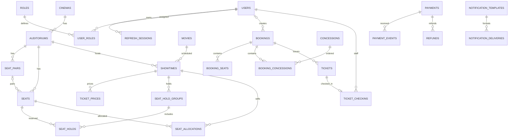

# ERD — Thiết kế dữ liệu PostgreSQL 17 / Knex 3 (3 Schemas: `core`, `payment`, `notification`)

**Mức độ:** Logical & physical schema design; quy tắc dữ liệu D-04 (`ACCEPTED — REVISED`: 3 services / 3 schemas) và D-05..D-18 đã **[ACCEPTED 2026-11-18]**; chưa chạy migration nghiệp vụ ở bước scaffolding. Các ràng buộc xuyên service (`core` ↔ `payment` ↔ `notification`) phải kiểm bằng workflow/API, không tạo FK vật lý xuyên schema.

## 1. Quy tắc chung

- `id`: UUID, `created_at`, `updated_at` UTC `timestamptz`, các số tiền `amount_vnd BIGINT` (không âm), `expires_at timestamptz`.
- Identifier/JSON/database cột dùng tiếng Anh; nội dung hiển thị tiếng Việt (`Asia/Ho_Chi_Minh`).
- Index ở mọi foreign key nội bộ cùng schema, `(showtime_id, seat_id)`, `status`, thời gian, tên/tìm kiếm.
- Soft delete dữ liệu có booking tham chiếu; không hard delete lịch sử thanh toán/vé.

## 2. Phân vùng 3 Schemas & Ánh xạ bảng (Migration Mapping từ thiết kế cũ)

Theo quyết định **D-04 (`ACCEPTED — REVISED`)**, một PostgreSQL 17 duy nhất được chia thành 3 schema theo ranh giới sở hữu dịch vụ:

1. **Schema `core` (thuộc `core-service`)**: Tiếp nhận toàn bộ bảng từ các nhóm `identity`, `catalog`, `showtime`, `operations` trước đây cùng với các bảng đặt vé, bắp nước và vé điện tử (`bookings`, `booking_seats`, `concessions`, `booking_concessions`, `tickets`).
2. **Schema `payment` (thuộc `payment-service`)**: Tiếp nhận các bảng giao dịch thanh toán, sự kiện webhook và hoàn tiền (`payments`, `payment_events`, `refunds`).
3. **Schema `notification` (thuộc `notification-service`)**: Chứa các bảng quản lý mẫu thông báo và lịch sử/trạng thái gửi thông báo (`notification_templates`, `notification_deliveries`).

---

### 2.1 Schema `core` (Owned by `core-service`)

#### Module Auth, Users & Roles (TV1)

| Bảng (`core.*`) | PK | Các cột đáng chú ý | Ràng buộc |
|---|---|---|---|
| `users` | `id` | `email`, `password_hash`, `full_name`, `status`, `verified_at` | unique normalized email |
| `roles` | `id` | `code` (`customer/staff/manager/admin`) | unique code |
| `user_roles` | `id` | `user_id`, `role_id`, `cinema_id` nullable | unique scoped association |
| `refresh_sessions` | `id` | `user_id`, `token_hash`, `expires_at`, `revoked_at`, `rotated_from` | hash-only, rotation |
| `email_verifications` | `id` | `user_id`, `token_hash`, `expires_at`, `consumed_at` | one-use hash |

#### Module Movies, Cinemas, Auditoriums & Seats (TV2)

| Bảng (`core.*`) | PK | Các cột đáng chú ý | Ràng buộc |
|---|---|---|---|
| `movies` | `id` | `title`, `synopsis`, `duration_min`, `age_rating`, `poster_url`, `status` | `duration_min > 0` |
| `cinemas` | `id` | `name`, `address`, `city`, `status` | `name + address` indexed |
| `auditoriums` | `id` | `cinema_id`, `name`, `supported_formats`, `status` | `unique(cinema_id, name)` |
| `seat_pairs` | `id` | `auditorium_id`, `created_at` | `unique(id, auditorium_id)` (D-15) |
| `seats` | `id` | `auditorium_id`, `row_label`, `seat_number`, `seat_type`, `couple_pair_id` nullable, `is_active` | `unique(auditorium_id, row_label, seat_number)`; couple pair đúng 2 ghế |

#### Module Showtimes, Pricing & Seat Holds (TV3 — Authoritative Seat Owner)

| Bảng (`core.*`) | PK | Các cột đáng chú ý | Ràng buộc |
|---|---|---|---|
| `showtimes` | `id` | `movie_id`, `auditorium_id`, `starts_at`, `ends_at`, `format`, `state`, `cinema_id` | `ends_at > starts_at`; prevent overlap + 15m buffer (D-11) |
| `ticket_prices` | `id` | `showtime_id`, `seat_type`, `amount_vnd` | `unique(showtime_id, seat_type)` |
| `seat_hold_groups` | `id` | `showtime_id`, `owner_ref`, `expires_at`, `status`, `idempotency_key` | hold lifecycle (TTL 300s, D-05) |
| `seat_holds` | `id` | `hold_group_id`, `showtime_id`, `seat_id`, `expires_at`, `status` | partial unique active holds |
| `seat_allocations` | `id` | `showtime_id`, `seat_id`, `booking_id`, `status`, `confirmed_at` | partial unique active allocation |

#### Module Bookings, Concessions & Tickets (TV4)

| Bảng (`core.*`) | PK | Các cột đáng chú ý | Ràng buộc |
|---|---|---|---|
| `bookings` | `id` | `booking_code`, `user_id` nullable (integer, khớp `core.users.id`), `contact_name`, `contact_email`, `contact_phone` nullable, `guest_token_hash` nullable, `hold_group_id`, `payment_id` nullable (logical ref), `idempotency_key`, `status`, `total_vnd`, `expires_at`, `confirmed_at`, `cancelled_at` | owner XOR (`user_id` hoặc `guest_token_hash`); `unique(booking_code)`; `unique(hold_group_id, idempotency_key)`; tối đa 1 booking active/hold; CHECK status + money >= 0 |
| `booking_seats` | `id` | `booking_id`, `showtime_id`, `seat_id`, `unit_price_vnd` | `unique(booking_id, seat_id)`, price >= 0; max 8 seats (D-06) do service kiểm |
| `concessions` | `id` | `name`, `unit_price_vnd`, `is_available` | nonnegative integer VND |
| `booking_concessions` | `id` | `booking_id`, `concession_id`, `quantity`, `unit_price_vnd` | `quantity > 0` |
| `tickets` | `id` | `booking_id`, `showtime_id`, `seat_id`, `qr_token_hash`, `status`, `issued_at` | unique `qr_token_hash`; `unique(booking_id, seat_id)`; 1 vé live (status <> cancelled) / (showtime, seat) |

#### Module Check-ins & Reports (TV5)

| Bảng (`core.*`) | PK | Các cột đáng chú ý | Ràng buộc |
|---|---|---|---|
| `ticket_checkins` | `id` | `ticket_id`, `staff_id`, `showtime_id`, `checked_in_at` | `unique(ticket_id)` (check-in tối đa 1 lần, cửa sổ [-30,+30]p D-10) |
| `audit_logs` | `id` | `actor_id`, `action`, `target_id`, `metadata_redacted`, `at` | append-only |

---

### 2.2 Schema `payment` (Owned by `payment-service` — TV4)

| Bảng (`payment.*`) | PK | Các cột đáng chú ý | Ràng buộc |
|---|---|---|---|
| `payments` | `id` | `booking_id` (logical ref tới `core.bookings`), `provider`, `provider_payment_id`, `status`, `amount_vnd`, `idempotency_key`, `processed_at` | `unique(booking_id, idempotency_key)`; unique `(provider, provider_payment_id)` khi không NULL; BIGINT VND >= 0 (D-18) |
| `payment_events` | `id` | `provider_event_id`, `payment_id`, `event_type`, `received_at` | `unique(provider_event_id)` (webhook idempotency D-09); không có `signature_valid` vì chỉ lưu event đã xác thực chữ ký |
| `refunds` | `id` | `payment_id`, `booking_id`, `amount_vnd`, `reason`, `status`, `idempotency_key`, `processed_at` | mock refund tracking (D-07, D-09); `unique(idempotency_key)`; tối đa 1 refund không `failed` / payment |

---

### 2.3 Schema `notification` (Owned by `notification-service` — TV5)

| Bảng (`notification.*`) | PK | Các cột đáng chú ý | Ràng buộc |
|---|---|---|---|
| `notification_templates` | `id` | `code` (`booking_confirmed`, `ticket_issued`, `booking_cancelled`, `refund_processed`), `subject_template`, `body_template`, `is_active` | `unique(code)` |
| `notification_deliveries` | `id` | `idempotency_key`, `template_code`, `recipient_email`, `booking_id` nullable, `payment_id` nullable, `status` (`queued/sent/failed`), `attempt_count`, `last_error`, `sent_at` | `unique(idempotency_key)` |

---

## 3. Quan hệ tổng thể



*(Lưu ý: `BOOKINGS.id` được tham chiếu logic bởi `payment.payments.booking_id` và `notification.notification_deliveries.booking_id`; không tạo foreign key xuyên schema giữa `core`, `payment` và `notification`.)*

## 4. Physical/Index Constraints mẫu (Knex migration checklist)

```sql
-- Schema core
CREATE UNIQUE INDEX uq_seat_allocation_active
  ON core.seat_allocations(showtime_id, seat_id)
  WHERE status = 'active';
CREATE UNIQUE INDEX uq_seat_hold_active
  ON core.seat_holds(showtime_id, seat_id)
  WHERE status = 'active';
CREATE UNIQUE INDEX uq_checkin_ticket
  ON core.ticket_checkins(ticket_id);
CREATE INDEX idx_showtime_filter
  ON core.showtimes(cinema_id, starts_at, state);

-- Schema payment
CREATE UNIQUE INDEX uq_payment_event_id
  ON payment.payment_events(provider_event_id);

-- Schema notification
CREATE UNIQUE INDEX uq_notification_idempotency
  ON notification.notification_deliveries(idempotency_key);
```

## 5. Ràng buộc ghế đôi & giới hạn đặt vé — ACCEPTED D-06/D-12/D-15/D-18

- `core.seats.couple_pair_id UUID NULL`; `seat_type='couple'` yêu cầu non-null pair id, còn loại khác phải null. Trong cùng auditorium, `couple_pair_id` ánh xạ **đúng 2** seat IDs.
- Max `seatIds.length = 8` tính theo ghế vật lý (1 cặp ghế đôi tính 2 ghế).
- Core Service là nguồn sự thật duy nhất đối với `seat_holds` và `seat_allocations`; vé (`core.tickets`) chỉ được phát hành sau khi xác nhận thanh toán từ `payment-service` và hoàn tất phân bổ ghế trong transaction tại `core-service`.
